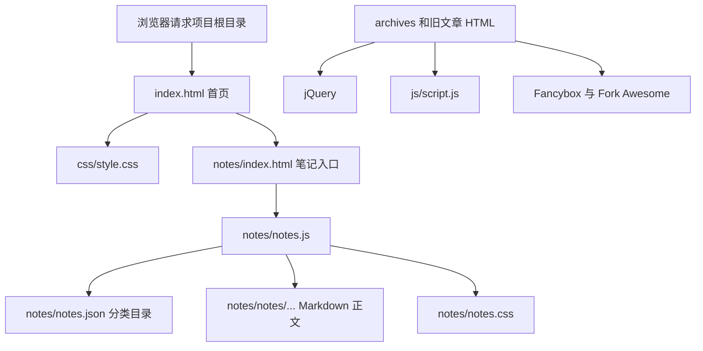

# Diogenes 网站项目源码解析与本地复现教程

> 本文根据当前项目目录中的实际文件编写，说明页面由哪些技术组成、各文件如何协作，以及怎样在本地运行、修改和部署。项目目录中没有完整的 Hexo 源码或依赖清单，因此“复现”指运行和修改现有静态站点，不代表从零重建原始 Hexo 工程。

## 1. 项目概况与技术栈

这是一个**静态个人学习网站**。它由两个时期的页面组成：根目录是后来定制的学习空间首页和笔记浏览页；`archives/` 与 `2026/.../hello-world/` 保留了旧 Hexo 博客导出的静态页面。

| 层次 | 当前实现 | 用途 |
| --- | --- | --- |
| 页面结构 | HTML5 | 首页、笔记目录、旧归档页和文章页 |
| 页面样式 | CSS3 | 首页视觉样式、笔记页样式、旧 Hexo 页面引用的样式路径 |
| 交互 | 原生 JavaScript + jQuery 3.6.4 | 笔记搜索/渲染使用原生 JS；旧博客交互使用 jQuery |
| 笔记数据 | JSON + Markdown | `notes.json` 保存标题、分类和路径；Markdown 保存教程正文 |
| 图片展示 | Fancybox | 旧 Hexo 页面中的图片灯箱插件 |
| 图标 | Fork Awesome CDN | 旧 Hexo 页面引用的外部图标字体 |
| 后端 / 数据库 | 无 | 页面运行时不调用项目自建 API，也没有服务端数据层 |
| 构建工具 | 当前没有可复现的构建配置 | 没有 `package.json`、Hexo 配置或源文章目录；现存网页文件可直接静态托管 |

首页展示的“FastAPI Backend”“Blog System”等是个人方向和项目介绍文案；这个仓库本身没有 FastAPI、PostgreSQL、Redis 或 TypeScript 应用代码。

## 2. 目录结构

```text
项目根目录/
├── index.html                         # 定制版首页
├── css/
│   ├── style.css                      # 当前首页的主样式
│   └── images/banner.jpg              # 旧 Hexo 页面原有横幅资源
├── js/
│   ├── jquery-3.6.4.min.js            # jQuery 第三方压缩文件
│   └── script.js                      # 旧博客的搜索、分享、图片和移动导航交互
├── fancybox/
│   ├── jquery.fancybox.min.css        # Fancybox 第三方样式
│   └── jquery.fancybox.min.js         # Fancybox 第三方脚本
├── notes/
│   ├── index.html                     # 笔记单页应用外壳
│   ├── notes.css                      # 笔记列表、文章和代码块样式
│   ├── notes.js                       # 搜索、分类、Markdown 子集渲染
│   ├── notes.json                     # 笔记目录数据
│   └── notes/
│       ├── development/*.md           # FastAPI、Redis、PostgreSQL 教程
│       └── privacy/*.md               # 联邦学习教程
├── archives/
│   ├── index.html                     # Hexo 归档页
│   └── 2026/.../index.html            # 按年、月生成的归档页
└── 2026/03/31/hello-world/index.html  # Hexo 示例文章的静态导出
```

`jquery-3.6.4.min.js`、Fancybox 文件是第三方压缩资源，通常不直接修改。需要自定义页面行为时，优先修改 `js/script.js` 或 `notes/notes.js`。

## 3. 页面请求与数据流



首页是普通 HTML，浏览器可直接解析。笔记页会通过 `fetch()` 读取 JSON 和 Markdown，因此应通过本地 HTTP 服务打开；直接双击 `file://` 文件可能被浏览器的跨域规则阻止。

## 4. 首页：`index.html` 与 `css/style.css`

### 4.1 页面分区

根目录 `index.html` 是独立的单页首页，主要包含：

1. **顶部导航**：使用 `#notes`、`#projects`、`#about` 锚点跳转。
2. **Hero 区**：显示站点定位、标题、简介和 GitHub 入口。
3. **Current Focus 卡片**：用静态文案列出当前关注方向。
4. **Knowledge Garden**：四个分类卡片链接到笔记页，并用 `category` 查询参数预选分类。
5. **Projects / About / Footer**：项目介绍、个人简介和页脚。

分类链接形如：

```text
notes/index.html?category=开发与工程
```

`notes.js` 读取查询参数决定初始分类。首页没有模板系统，改文案直接编辑 HTML；添加分类入口时，要同时确认笔记 JSON 中存在同名分类。

### 4.2 首页样式

`css/style.css` 使用系统字体、浅色底色、固定的径向渐变背景、渐变大标题、半透明卡片和 CSS Grid。宽度小于 800px 时，Hero 改为纵向排列，分类卡片改为单列。首页分类卡片和“浏览全部学习笔记”链接的少量补充样式写在 `index.html` 的内嵌 `<style>` 中。

如果继续扩展首页样式，建议逐步把内嵌规则迁入 `css/style.css`，避免同一组件的规则散落在多个文件。

## 5. 笔记浏览页：HTML、JSON、Markdown 与原生 JS

### 5.1 页面外壳

`notes/index.html` 提供搜索框、分类栏、列表容器和文章容器。它加载 `notes.css` 与 `notes.js`，不依赖 jQuery。页面内容由脚本根据数据生成。

### 5.2 数据目录：`notes/notes.json`

每条记录包含：

```json
{
  "title": "Redis 数据类型与过期策略",
  "category": "开发与工程",
  "subCategory": "Redis",
  "path": "development/redis-data-types-and-ttl.md"
}
```

- `title`：列表卡片和文章页标题。
- `category`：侧栏筛选分类；首页分类链接也依赖这个名称。
- `subCategory`：卡片上的细分主题，并参与搜索。
- `path`：相对于 `notes/notes/` 的 Markdown 文件路径。

### 5.3 列表与搜索：`notes/notes.js`

页面加载时，脚本先请求 `notes.json`，由记录中的 `category` 自动生成侧栏分类及数量。搜索框会匹配标题、一级分类、细分主题和文件路径。点击分类会使用 `history.pushState()` 更新 URL，并重新筛选列表；点击卡片会把笔记文件路径写入 `?note=` 参数。

打开文章时，脚本请求 `notes/notes/<path>`，解析 Markdown，再把标题和正文放入文章容器。渲染前的 `esc()` 会转义文本中的 `&`、`<`、`>`、引号，避免普通笔记文本被当作 HTML 标签执行。外部 Markdown 链接只接受 `http` / `https` 形式。

### 5.4 当前支持的 Markdown 子集

渲染器是项目内手写的轻量解析器，不是完整 CommonMark/Obsidian 解析器。当前实现支持：

- YAML frontmatter（解析时整体略过）；
- 标题、段落、无序列表和有序列表；
- 引用块、围栏代码块和简单表格；
- 行内代码、粗体、斜体和 HTTP(S) 链接；
- `[[页面名]]` / `[[页面名|显示文字]]`（展示名称，但不会自动跳转）；
- `![[图片]]`（显示图片占位文字，不会读取 Obsidian 附件）。

复杂嵌套列表、完整表格语法、数学公式、Mermaid、HTML、脚注和 Obsidian 嵌入目前不保证正确显示。若笔记依赖这些特性，需要扩展解析器或接入 Markdown 渲染库。

### 5.5 代码块显示

围栏开头的语言名用于代码块顶部标签，例如 ```` ```python ````。渲染器根据语言名调用 `highlightCode()`：它先按词法模式识别字符串、注释、数字、关键字和函数名，再对每个文本片段执行 HTML 转义，最后包上 `syntax-*` 类名。这样代码只作为文本呈现，不会把示例中的 HTML 当作页面标签执行。

当前别名包括 `py` → Python、`js` → JavaScript、`ts` → TypeScript、`sh` / `shell` → Bash、`yml` → YAML、`ps1` → PowerShell。`highlightCode()` 中的 `sets` 保存各语言关键字；未配置的语言使用一组通用关键词。`notes.css` 通过 `.syntax-keyword`、`.syntax-string`、`.syntax-comment`、`.syntax-number` 和 `.syntax-function` 定义颜色。

这个实现是轻量词法着色，不是完整语法分析器：它不构建 AST，也不能完整识别每种语言的上下文、嵌套模板字符串、正则字面量或同名标识符的语义。增加语言时，在 `notes.js` 的 `aliases` / `sets` 增补名称和关键字；如果需要新 token 类型，再为它增加对应的 CSS 类。

每行再由 `.code-line` 包装，CSS 显示行号、深色背景和窄屏横向滚动。复制按钮优先使用 Clipboard API，失败时尝试浏览器的旧式复制接口。行号通过 CSS 伪元素显示，因此复制的文本不包含行号。

### 5.6 添加一篇教程

1. 在 `notes/notes/` 下创建 Markdown 文件，例如 `development/my-guide.md`。
2. 在 `notes/notes.json` 中增加一条记录，`path` 写成相对于 `notes/notes/` 的路径。
3. 确认 `category` 与首页入口使用的分类名称一致。
4. 通过本地 HTTP 服务打开笔记页，检查搜索、分类和文章渲染。

教程正文中的代码块可以写语言名：

````markdown
```python
print("hello")
```
````

## 6. 旧博客交互：`js/script.js`

此脚本针对旧 Hexo 页面中的 DOM 结构编写，并通过 jQuery 就绪后的 IIFE 运行：

```javascript
(function ($) {
  // 选择元素、注册事件
})(jQuery);
```

根目录新版首页不会加载这段脚本；脚本选择器找不到元素时，jQuery 通常只会得到空集合，因此不会替新版首页提供交互。

### 6.1 搜索面板

点击 `.nav-search-btn` 后，脚本给 `#search-form-wrap` 添加 `on`，等待 200ms 后聚焦搜索框。输入框失焦时移除 `on`。动画锁用于避免连续点击在过渡期重复切换状态。

### 6.2 分享面板

点击 `.article-share-link` 时，脚本读取 `data-url`、`data-title` 和 `data-id`，创建分享弹层及 Twitter、Facebook、Pinterest、LinkedIn 链接。点击页面空白处会移除弹层的 `on` 状态。

代码中还注册了 `.article-share-box-input` 和 `.article-share-box-link` 的事件，但动态创建的元素类名分别是 `.article-share-input` 与社交站点专用类。这些选择器与生成的 DOM 不完全一致，所以选中 URL、统一弹出分享窗口的辅助行为可能不会生效。

### 6.3 图片说明与 Fancybox

脚本遍历 `.article-entry` 中的图片：如果图片尚未处于链接内，就根据 `alt` 添加说明文字，并把图片包进可点击的链接。之后按文章编号设置图片组关系；当 `$.fancybox` 存在时，初始化 `.fancybox` 元素。

### 6.4 移动导航

点击 `#main-nav-toggle` 会切换 `#container` 的 `mobile-nav-on` 类；点击 `#wrap` 的页面内容区域则关闭移动导航。CSS 决定这个状态下导航如何呈现。

## 7. Hexo 静态导出页面与第三方资源

`archives/` 和 `2026/03/31/hello-world/` 中的 HTML 带有 `meta name="generator" content="Hexo 8.1.1"`，结构来自 Hexo 默认 Landscape 风格页面。它们是**生成后的静态 HTML**，不是 Hexo 的 Markdown 源文件。

这些旧页面引用：

- `/css/style.css`；
- `/js/jquery-3.6.4.min.js` 与 `/js/script.js`；
- `/fancybox/jquery.fancybox.min.css` 与 `.js`；
- jsDelivr 上的 Fork Awesome 字体样式。

当前 `css/style.css` 已是短小的新版首页样式，并不包含旧 Landscape 页面所需的大量 `.outer`、`.article-entry`、`.archive-article` 等布局规则。因此旧归档 HTML 虽然还在，视觉上未必保留原 Hexo 主题的完整样式。旧 HTML 还残留 `Hexo`、`John Doe`、`example.com`、默认 Hello World 文案和 `/favicon.png` 引用；项目文件清单中没有 `favicon.png`。这类内容属于模板占位，不应误认为当前首页的数据来源。

旧 HTML 使用以 `/` 开头的根路径资源链接，适合部署在域名根路径。若部署到 `username.github.io/repository/` 这样的子路径，需要统一调整资源和页面链接，或配置正确的站点 base URL 后重新生成页面。

## 8. 本地运行与复现

项目是静态站点，不需要安装 npm 包或启动数据库。由于笔记页通过 `fetch()` 读取本地 JSON/Markdown，使用本地 HTTP 服务打开最稳妥。

### Windows PowerShell

```powershell
cd "项目文件夹的完整路径"
py -m http.server 8000
```

如果系统没有 `py` 启动器，也可以试：

```powershell
python -m http.server 8000
```

然后在浏览器访问：

```text
http://localhost:8000/
```

首页通过 `notes/index.html` 进入笔记目录。终止服务时回到运行服务的终端按 `Ctrl+C`。

### macOS / Linux

```bash
cd "/path/to/项目目录"
python3 -m http.server 8000
```

访问地址相同。若 8000 端口已被占用，可换成 8080，并相应访问 `http://localhost:8080/`。

### 发布到静态托管

把项目目录中的 HTML、CSS、JS、JSON、Markdown 和资源文件一起上传到静态托管服务，保持目录层级不变。这里没有构建步骤，也没有服务端环境变量。部署后应检查：

1. 首页 CSS 是否加载；
2. `notes/notes.json` 是否能返回；
3. 笔记 Markdown 路径是否大小写和目录完全匹配；
4. 外部 Fork Awesome CDN 是否可用；
5. 若部署在子路径，旧归档页的根路径链接是否需要调整。

## 9. 常见问题

| 现象 | 常见原因 | 排查方式 |
| --- | --- | --- |
| 笔记页一直显示“正在整理目录” | JSON 请求失败或通过 `file://` 打开 | 使用本地 HTTP 服务；检查 `notes/notes.json` 路径和 JSON 格式 |
| 分类卡片点开后结果为空 | `category` 查询参数与 JSON 中的分类名不同 | 确认两处字符串完全一致，包含空格和中文 |
| 列表能看见但文章无法打开 | `path` 不对应实际文件或 URL 编码路径错误 | 确认文件位于 `notes/notes/` 下，路径使用 `/` 分隔 |
| Markdown 公式或嵌入显示不完整 | 当前解析器只支持 Markdown 子集 | 改用支持所需语法的解析器或扩展 `markdown()` |
| 旧归档页布局异常 | 新版 `css/style.css` 不含旧 Hexo 主题规则 | 恢复旧主题 CSS，或重新设计归档页并统一样式 |
| 旧文章的分享/搜索图标不显示 | Fork Awesome 走外部 CDN，可能被网络拦截 | 检查网络请求，或改成本地托管图标资源 |

## 10. 文件修改地图

| 想修改什么 | 编辑文件 |
| --- | --- |
| 首页文案、区块、导航链接 | `index.html` |
| 首页背景、卡片、断点布局 | `css/style.css`，少量首页补充规则还在 `index.html` 内 |
| 笔记搜索、分类和 Markdown 解析 | `notes/notes.js` |
| 笔记页和代码块视觉效果 | `notes/notes.css` |
| 笔记列表和分类数据 | `notes/notes.json` |
| 教程正文 | `notes/notes/<分类>/<文件名>.md` |
| 旧 Hexo 页面交互 | `js/script.js` |
| 旧文章、归档静态输出 | `2026/` 与 `archives/`；它们不是当前的 Hexo 源文件 |

## 11. 复现边界总结

拿到当前目录即可启动并展示已有静态页面，也能继续维护新版首页和笔记目录。若要“重新运行 Hexo 生成旧归档”，还需要补齐 Hexo 源工程（如 `package.json`、站点配置、主题配置、Markdown 文章和依赖版本）。这些构建源文件当前不在项目目录中，所以本文不虚构 Hexo 安装命令或声称可从当前目录重新生成旧页面。
